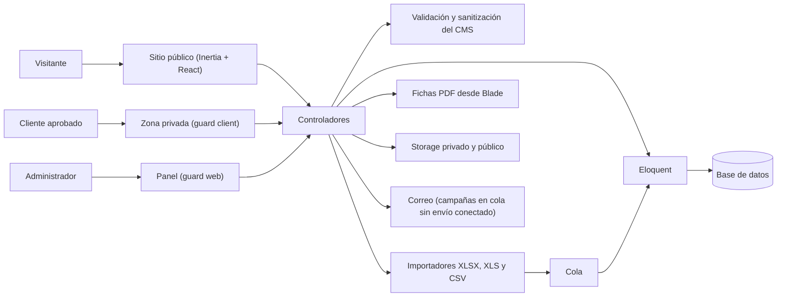
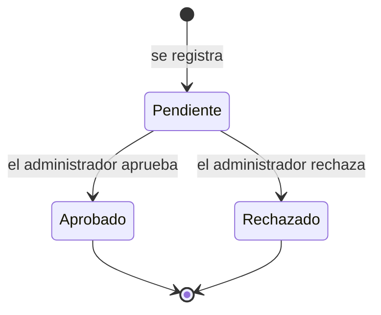
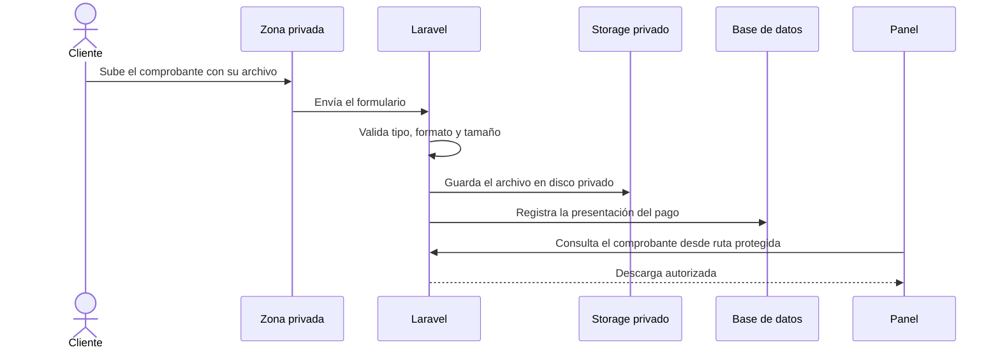
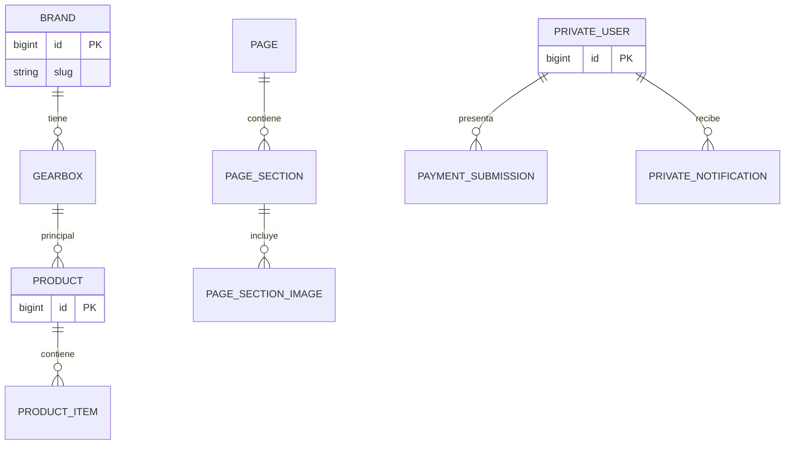

<div align="center">

<br/>

**Sitio corporativo con catálogo técnico de cajas de cambio, zona privada de clientes y panel de gestión.**


</div>


## 📑 Contenido

[El problema](#-el-problema) · [La solución](#-la-solución) · [Funcionalidades](#-funcionalidades) · [Arquitectura](#-arquitectura) · [Flujos de trabajo](#-flujos-de-trabajo) · [Modelo de datos](#-modelo-de-datos) · [Criterios y decisiones](#-criterios-y-decisiones) · [Stack](#-stack) · [Estructura](#-estructura-del-repo) · [Puesta en marcha](#-puesta-en-marcha) · [Pruebas y calidad](#-pruebas-y-calidad) · [Despliegue](#-despliegue) · [Estado y pendientes](#-estado-y-pendientes) · [Licencia y autoría](#-licencia-y-autoría)


## 🧩 El problema

Encontrar una pieza para una caja de cambios exige cruzar marca, caja, producto y códigos de fabricante original (OEM). Ese cruce se hacía en planillas, y los precios y documentos de los clientes mayoristas no tenían un lugar propio: se enviaban por otros medios y se actualizaban a mano.

## 💡 La solución

**Gran Sasso** es una aplicación Laravel con tres perfiles:

- **Visitantes**: sitio institucional y catálogo navegable por marca, caja de cambios y producto, con fichas PDF y documentación.
- **Clientes registrados**: zona privada con listas de precios, novedades, notificaciones e información de pagos. Las cuentas nuevas quedan pendientes hasta que el equipo las aprueba.
- **Administración**: panel para catálogo, importaciones, CMS, usuarios, mensajes y estadísticas.


## ✨ Funcionalidades

**Sitio público** (rol: visitante)
- Inicio, empresa, calidad, novedades, contacto y desarrollos especiales.
- Catálogo por marca, caja y producto, con búsqueda, imágenes, documentación y fichas PDF.
- Suscripción a newsletter y acceso flotante a WhatsApp con enlace configurable.

**Zona privada** (rol: cliente aprobado)
- Listas de precios, novedades y notificaciones.
- Presentación de comprobantes de pago con archivo adjunto.

**Panel administrativo** (rol: administrador)
- Marcas, cajas, productos y sus ítems, con códigos OEM, aplicaciones y variantes.
- Importación de XLSX, XLS y CSV en formato plano y de catálogo, con autodetección, agrupación y reporte de altas, actualizaciones y errores.
- CMS de páginas, secciones, banners, sliders, galería, calidad, novedades, SEO y datos de contacto.
- Aprobación de clientes, usuarios, mensajes y registro de visitas para el dashboard.


## 🏗️ Arquitectura

Monolito Laravel con tres guards de acceso: `web` para el panel, `client` para la zona privada y el público sin autenticación. Las páginas usan Inertia con React y las plantillas de PDF se generan en Blade. Los contenidos se guardan en JSON con fallback a español.






## 🔄 Flujos de trabajo

**Alta y aprobación de un cliente**



**Comprobante de pago**




## 🗃️ Modelo de datos

Eloquent con 65 migraciones y 31 modelos en el repositorio.



La caja es única por marca y slug; el producto, por caja y código Gran Sasso. Un producto tiene una caja principal y puede vincularse a cajas secundarias. Cada ítem conserva códigos OEM y aplicaciones sin duplicar el producto base.


## 🧭 Criterios y decisiones

- **Producto base con ítems.** Un mismo producto agrupa códigos OEM y variantes, para no repetir la pieza por cada código.
- **Clientes aprobados antes de ver precios.** Las cuentas nuevas pasan por aprobación administrativa.
- **Guards separados.** Panel y zona privada tienen usuarios, proveedores y sesiones independientes.
- **Documentos privados.** Comprobantes y adjuntos de desarrollos viven en almacenamiento privado y se descargan solo por rutas protegidas.

| Decisión | Por qué |
| --- | --- |
| Monolito con Inertia y React | Un solo despliegue y una sola base para sitio, zona privada y panel. |
| Importación con detección de formato | El catálogo llega en planillas planas o jerárquicas. |
| Contenido multilingüe en JSON | Español, inglés y portugués en un mismo registro, con fallback a español. |


## 🧱 Stack

| Capa | Tecnología | Versión |
| --- | --- | --- |
| Lenguaje | PHP | ^8.2 |
| Backend | Laravel framework | ^12 (lock 12.54.1) |
| Integración panel | inertiajs/inertia-laravel | 2.0.22 |
| API y sesiones | Laravel Sanctum | 4.3.1 |
| Importación | maatwebsite/excel | 3.1.67 |
| Frontend | React | 18.3.1 |
| Frontend | @inertiajs/react | 2.3.18 |
| Estilos | Tailwind CSS | 4.2.1 |
| Build | Vite | 7.3.1 |
| Base de datos | SQLite en `.env.example`; otras conexiones por configuración | — |


## 🗂️ Estructura del repo

```text
app/Http/Controllers/     público, zona privada y administración
app/Models/               entidades Eloquent (31)
database/migrations/      esquema relacional (65)
resources/js/             páginas y componentes React (Inertia)
resources/views/          Blade para el público y las fichas PDF
routes/                   rutas públicas, privadas y del panel
storage/                  archivos privados y públicos
tests/                    pruebas unitarias y feature
```


## 🚀 Puesta en marcha

Requisitos: PHP 8.2+, Composer, Node.js y npm.

```bash
composer install
npm ci
cp .env.example .env              # definir base, correo y almacenamiento localmente
php artisan key:generate
touch database/database.sqlite    # si se usa SQLite
php artisan migrate --seed
php artisan storage:link
composer run dev                  # servidor, cola, logs y Vite en paralelo
```

Variables relevantes (por nombre): `DB_*`, `MAIL_*`, `QUEUE_CONNECTION`, `FILESYSTEM_*` y la lista de correos administradores, configurada fuera del código. Los valores reales no se versionan.


## 🧪 Pruebas y calidad

Pruebas unitarias y feature sobre la portada y el flujo de autenticación administrativa: render del login, credenciales válidas e inválidas y cierre de sesión.

```bash
composer test
vendor/bin/pint --test
npm run build
```

La última ejecución registrada en la versión anterior de este README fue de 6 pruebas aprobadas; no se volvió a ejecutar para este cambio. No hay pruebas E2E, de carga ni pipeline CI versionados.


## 🚢 Despliegue

No definido en el repositorio. No hay manifiestos Docker, Kubernetes ni configuración de CI/CD. Servidor web, workers, TLS, copias de seguridad y gestión de secretos se definen fuera del código.


## 📌 Estado y pendientes

- **Estado:** aplicación funcional con catálogo, CMS, zona privada, importaciones y panel. Producción no verificada.
- **Último commit:** 2026-04-30, `VERSION 1.3.5`, en el historial local.
- **Pendientes:**
  - La acción de envío de campañas de newsletter es un stub: la infraestructura de correo en cola existe, pero el controlador no despacha el job.
  - El acceso a WhatsApp es solo un enlace; no hay integración con su API.
  - Ampliar la cobertura de pruebas más allá de la portada y la autenticación.


## 📄 Licencia y autoría

Desarrollado por el **Ing. Santiago Abasto**.


Repositorio sin archivo de licencia. El código y el contenido son propiedad del cliente, Gran Sasso, salvo que se acuerde otra cosa.
